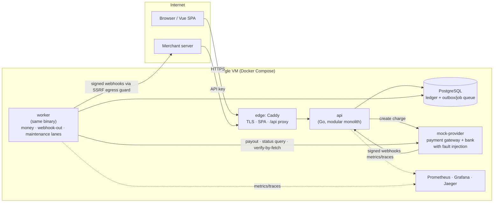

# LedgerPay

> A mini payment platform where money stays correct even when requests are duplicated, concurrent, or interrupted by failures.

**Status:** M3 (Sprint 7 of 10) — core money flows, background processing, observability, and a scripted deploy are done. Reconciliation, ops console, load test, and backup drills are next ([backlog](docs/backlog.md)).
**Live demo:** `[LINK: https://<domain> after the first deploy]` · **Demo video (~5 min):** `[LINK: video]`

Production-oriented, small in scope, strict about correctness. Built for learning and as a portfolio project.

---

## In 60 seconds

- **Send the same transfer twice** (client retry after a timeout) → money moves once; the retry gets the original response with `Idempotent-Replayed: true`.
- **Fire 100 concurrent transfers** of Rp10.000 at a Rp100.000 wallet → exactly 10 succeed, 90 are rejected, the balance never goes negative.
- **Kill the worker while the bank is processing a payout** → after restart the payout ends `SUCCEEDED` and the bank records exactly **one** transfer.

## What this demonstrates

| Problem | Guarantee | How | Proof |
|---|---|---|---|
| Client retries after a timeout | One intent = one financial effect | Idempotency key stored in the **same DB transaction** as the journal; concurrent duplicates wait on the unique index ([ADR-L02](docs/adr/ADR-L02-idempotency.md)) | `TestTransfer_IdempotentReplay`, `TestIdempotency_ConcurrentSameKey_OneEffect`, Demo A |
| Concurrent spending from one wallet | No double spend, no negative balance, no deadlock | Wallet rows locked `ORDER BY id FOR NO KEY UPDATE` + `CHECK (balance >= 0)` ([ADR-L03](docs/adr/ADR-L03-concurrency-pessimistic-locking.md)) | `TestTransfer_ConcurrentDoubleSpend_100x`, `TestTransfer_NaiveImplementation_Overdraws`, Demo B |
| Money created or lost by a bug | Every journal balances; the ledger is append-only | Double-entry ledger, deferred constraint trigger, grants + triggers forbid UPDATE/DELETE ([ADR-L01](docs/adr/ADR-L01-double-entry-ledger.md)) | `TestProperty_RandomTransfersConserveTotal`, `TestJournal_UnbalancedRejectedAtCommit`, invariant gauges = 0 |
| The bank times out ("did the money leave?") | Never pay twice, never lose money | `SUBMITTED` committed before the bank call; unknown outcomes become `UNKNOWN` and are resolved by status queries, resubmit only after the bank's safe window with the same key ([ADR-L06](docs/adr/ADR-L06-payout-unknown-outcome.md)) | `TestPayoutSubmit_CrashAfterBankAccepted_NoDoubleSend`, `TestPayout_TimeoutAfterProcess_ResolvesViaStatusQuery`, Demo C |
| Side effects lost on a crash | At-least-once with idempotent consumers; no event without a commit | Transactional outbox + PostgreSQL job queue with leases and **fencing** ([ADR-006](docs/adr/ADR-006-background-processing-postgres-queue.md)) | `TestJobRunner_FencedCompletion_ZombieRollsBack`, `TestJobRunner_LeaseExpiry_Reclaims` |
| Forged or duplicated provider webhooks | A webhook can never create money on its own | HMAC + timestamp, inbox dedupe, monotonic transitions, **verify-by-fetch** with the provider ([ADR-L08](docs/adr/ADR-L08-inbound-webhook-inbox.md)) | `TestInbox_VerifyByFetch_ForgedWebhookNoCredit`, `TestTopup_DuplicateWebhook_OneJournal` |

## Architecture



One Go binary runs as `api` and `worker`. PostgreSQL is the single source of truth **and** the queue: a request writes its financial effect, its idempotency record, and the jobs it implies in one transaction; the worker performs the side effects (bank calls, merchant webhooks) and records outcomes with fenced completion.

## Key design decisions

- **Modular monolith, not microservices** — money movement needs one ACID transaction; module boundaries are enforced by `depguard` ([ADR-001](docs/adr/ADR-001-modular-monolith.md)).
- **Idempotency in PostgreSQL, not Redis** — Redis and Postgres cannot commit atomically ([ADR-L02](docs/adr/ADR-L02-idempotency.md)).
- **Pessimistic, ordered locking** — hot wallets conflict constantly, so optimistic retries would storm; system accounts are never locked ([ADR-L03](docs/adr/ADR-L03-concurrency-pessimistic-locking.md), [ADR-L07](docs/adr/ADR-L07-hot-accounts.md)).
- **PostgreSQL-backed queue instead of a broker** — no dual writes ([ADR-006](docs/adr/ADR-006-background-processing-postgres-queue.md)).
- **Never guess a payout outcome** — `UNKNOWN` is an honest state ([ADR-L06](docs/adr/ADR-L06-payout-unknown-outcome.md)).
- **A separate mock provider** — real HTTP, real webhooks, and failure modes on demand ([ADR-L05](docs/adr/ADR-L05-mock-provider.md)).

## Failure scenarios

| Scenario | Detection | Handling | End state |
|---|---|---|---|
| FS-01 duplicate request | Same `(client, endpoint, key)` | Replay stored response; different payload → 422 | One effect |
| FS-02 concurrent payment | Row locks, guard `WHERE status = …` | Second request waits, then 422 / 409 | No double spend |
| FS-03/04 DB/API dies around COMMIT | Client sees 5xx | Retry with the same key → replay (committed) or first execution (rolled back) | One effect |
| FS-05 provider/bank timeout | HTTP timeout | Top-up: resume from recovery point; payout: `UNKNOWN` → status query | Resolved, never duplicated |
| FS-06/07 webhook duplicate, late, out of order | Inbox dedupe, monotonic transitions | `DUPLICATE` / `STALE` / `CONFLICT` (never reversed) | Credited exactly once |
| FS-08 worker crash | Lease expiry | Another worker reclaims; zombie writes are fenced | Exactly one outcome |
| FS-09 merchant endpoint down | Non-2xx | 1m → 24h backoff, 7 attempts → `DEAD` | Stable event id for dedupe |

Full list with tests: [traceability matrix](docs/design/22-testing-strategy.md#5-traceability-matrix).

## Run it

Requirements: Go (toolchain from `go.mod`), Docker with Compose, Node 22 + Yarn (SPA), `jq`.

```bash
make up                 # postgres + migrations + api + worker + mock-provider (LP_HTTP_PORT=18080 if 8080 is taken)
make demo-a             # idempotency
make demo-b             # 100 concurrent transfers
make demo-c             # payout timeout + docker kill worker (~60 s)
make demo-topup         # top-up through the mock provider, duplicate + forged webhooks
make demo-payment       # merchant API key → payment intent → two tabs confirm
make web                # SPA on http://localhost:5173
make up-obs             # + Grafana (http://localhost:3000), Jaeger (http://localhost:16686), Prometheus
```

Deploy to a VM: `deploy/prod/` (cloud-init + `bootstrap.sh` hardening, `init-env.sh` generates secrets, `deploy.sh <host> <sha>` uploads a git archive, migrates, health-gates, smoke-tests, and rolls back automatically on failure).

## Tech stack

| Area | Choice | Why |
|---|---|---|
| Backend | Go, chi, pgx, sqlc | Explicit SQL, compile-time checked queries ([ADR-002](docs/adr/ADR-002-tech-stack-go-vue.md), [ADR-005](docs/adr/ADR-005-data-access-sqlc.md)) |
| Database | PostgreSQL 17 | Constraints, deferred triggers, `SKIP LOCKED` ([ADR-004](docs/adr/ADR-004-postgresql.md)) |
| Frontend | Vue 3 + TypeScript + Vite | Access token in memory only, session restored from an HttpOnly cookie |
| Ops | Docker Compose, Caddy, Prometheus, Grafana, OpenTelemetry/Jaeger | Single VM, everything provisioned from the repo |
| CI | GitHub Actions | lint (golangci-lint incl. gosec/depguard), unit, integration (testcontainers), migration, E2E (Playwright) |

## Testing

- **128 Go tests** against a real PostgreSQL (testcontainers, one cloned template DB per test, app role — not superuser), plus Vitest and a Playwright journey (register → top-up via checkout → transfer → payout → login again).
- **Concurrency tests** with barriers and named test hooks (`-tags testhooks`) for deterministic interleavings; repeated `-count=20` before merging.
- **Property tests** (`rapid`): random transfer sequences conserve money.
- **"Test the test"**: mutation checks (e.g. removing lock ordering, verify-by-fetch, or the `SUBMITTED` guard must make tests fail) and a naive implementation that is shown to overdraw.
- **Alert rules are tested** with `promtool test rules`.

```bash
make test               # unit (no Docker)
make test-integration   # all integration + interleaving tests
make test-concurrency   # repeat concurrency tests 20×
make test-e2e           # Playwright (stack running)
```

## Observability

- Metrics catalogue: HTTP per route template, DB pool, job queue/outbox lag/dead letters, **ledger invariant gauges** (normally always 0), payouts in `UNKNOWN` and their age, idempotency replays, webhook outcomes.
- Two provisioned Grafana dashboards (*Money & Integrity*, *Platform*) and alert rules (invariant violated, payout unknown > 1 h, dead letters, 5xx ratio, readiness).
- Traces: HTTP → DB transactions/queries (sqlc query names, no SQL text or parameters) → outbound calls; jobs start a new root span **linked** to the request that enqueued them.

`[SCREENSHOT: Grafana Money & Integrity during Demo C]` · `[SCREENSHOT: Jaeger trace POST /v1/payouts → job payout.submit]`

## Performance baseline

Not measured yet (planned for Sprint 9 with k6 from a separate machine). This README will only show numbers together with the environment they were measured on:

| Scenario | Environment | Load | p95 | Invariants |
|---|---|---|---|---|
| Transfers | `[MEASURE]` | `[MEASURE]` | `[MEASURE]` | drift 0 |

## Security notes

Threat model: [docs/design/16-security-threat-model.md](docs/design/16-security-threat-model.md). Highlights: argon2id with bounded concurrency, refresh-token rotation with reuse detection, generic auth errors (no account enumeration, including no `Retry-After` oracle on lockout), BOLA → 404, merchant API keys hashed at rest with slot limits, HMAC webhooks with replay window, SSRF egress guard for merchant webhooks, AES-GCM encryption of account numbers and webhook secrets with a versioned keyring, least-privilege database roles. This project applies data-protection practices; it makes no compliance claims.

## Limitations & what's simplified

- Single VM; offsite backups and a restore drill are planned for Sprint 8. Deploys are scripted and roll back automatically, but not yet triggered by CI.
- The payment provider and the bank are mocks that mimic real APIs, including their failure modes.
- IDR only; no KYC, no cards, no MFA.
- Reconciliation (Demo D), refunds, and the ops console are not built yet.

## Project structure

```text
cmd/ledgerpay        api · worker · migrate · admin CLI (one binary)
cmd/mock-provider    mock payment gateway + bank
internal/modules     identity · ledger · wallet · transfer · merchant · payment · topup · inbox · payout · webhookout
internal/platform    db · idempotency · jobs · auth · ratelimit · egress · crypto · metrics · tracing · …
db/migrations        goose migrations (embedded)
web/                 Vue SPA + Playwright
deploy/              compose (dev + prod), Caddy, Prometheus rules, Grafana dashboards, VM scripts
docs/                ADRs, design documents, backlog
```

## Docs

[Design documents](docs/design/) · [ADRs](docs/adr/) · [OpenAPI](api/openapi.yaml) · [Backlog](docs/backlog.md)

## License

[MIT](LICENSE)
