# Step 4.2 — LedgerPay: ERD & Daftar Tabel

> Bagian dari [Step 4 — Database Design](00-index.md). Konvensi (PK UUIDv7, `bigint` minor unit, status `text + CHECK`, tanpa `deleted_at`, role `ledgerpay_owner`/`ledgerpay_app`) mengikuti index.
> Tabel shared (`users`, `refresh_tokens`, `idempotency_keys`, `jobs`, `audit_log`) dispesifikasikan di [`01-shared-tables.md`](01-shared-tables.md). Di sini tabel-tabel itu hanya ditampilkan sebagai konteks relasi.
> Schema: `ledgerpay`. Mock provider memakai database terpisah `mockprovider` (lihat [`04-…`](04-ledgerpay-consistency-and-indexing.md) §7).

---

## 1. Keputusan pemodelan yang mempengaruhi ERD

| # | Pertanyaan | Keputusan | Alasan |
|---|---|---|---|
| D1 | Kepemilikan account: polimorfik (`owner_type`, `owner_id`) atau FK nyata? | **FK nyata**: `accounts.user_id` **atau** `accounts.merchant_id` (nullable, tepat satu terisi untuk wallet), atau `system_code` untuk akun sistem. Ditegakkan oleh `CHECK` | Polimorfik tidak bisa punya FK, sehingga akun yatim bisa muncul. Dengan dua kolom nullable + CHECK, integritas referensial tetap dijaga DB |
| D2 | Rekening bank tujuan payout: tabel `bank_accounts` tersimpan atau snapshot inline? | **Snapshot inline di `payouts`**: `bank_code`, `account_number_enc` (AES-GCM), `account_number_last4`, `holder_name` | Payout harus mencatat **ke mana uang benar-benar dikirim saat itu**. Rekening tersimpan yang diedit belakangan tidak boleh mengubah riwayat. Fitur "rekening favorit" tidak ada di scope; kalau ditambah nanti, tabel itu menjadi *sumber* snapshot, bukan pengganti |
| D3 | Endpoint webhook merchant: tabel terpisah atau kolom di `merchants`? | **Kolom di `merchants`** (`webhook_url`, `webhook_secret_enc`) | Satu endpoint per merchant sudah memenuhi LF-15. Migrasi ke `merchant_webhook_endpoints` baru dilakukan kalau ada kebutuhan multi-endpoint atau filter event |
| D4 | Role ops | **`users.role text CHECK (role IN ('USER','OPS'))`** (varian LedgerPay dari tabel shared `users`) | Hanya dua role, tanpa multi-tenant. Tabel `user_roles` adalah over-engineering |
| D5 | `journals.source_id`: FK? | **Tanpa FK** (referensi polimorfik ke `topups`/`transfers`/…), dijaga oleh `CHECK` pasangan `purpose ↔ source_type` + `UNIQUE (source_type, source_id, purpose)` | Journal append-only dan mereferensikan 7 jenis sumber. FK dari arah sebaliknya (`topups.journal_id`, `payouts.hold_journal_id`, …) memberi integritas yang dibutuhkan |
| D6 | `journals.idempotency_key_id`: FK ke `idempotency_keys`? | **Tanpa FK**, cukup UUID biasa | `idempotency_keys` di-hard-delete setelah 7 hari. FK `ON DELETE SET NULL` akan gagal karena journal immutable (trigger menolak UPDATE). Nilai ini hanya untuk traceability (LI-14) |
| D7 | Pengiriman webhook ke merchant: tabel itu sendiri yang menjadi queue, atau digerakkan `jobs`? | **Digerakkan `jobs`** (kind `webhook.deliver`, jadwal retry per kind), dengan `webhook_deliveries` sebagai status bisnis + `webhook_delivery_attempts` sebagai riwayat | Satu job runner untuk semua kerja async (ADR-006); `webhook_deliveries` tetap bisa di-query ops |
| D8 | Inbox webhook: claim sendiri atau lewat `jobs`? | **Claim sendiri** (`SKIP LOCKED` di `webhook_inbox`), sesuai ADR-L08 | Row inbox ditulis oleh handler HTTP tanpa logika bisnis lain; menambah job berarti dua insert untuk setiap webhook tanpa manfaat |

---

## 2. ERD

```mermaid
erDiagram
    users ||--o| accounts : "owns wallet"
    merchants ||--o| accounts : "owns wallet"
    merchants ||--o{ merchant_api_keys : "has"
    users ||--o{ refresh_tokens : "has"

    journals ||--|{ journal_entries : "contains"
    accounts ||--o{ journal_entries : "posted to"
    journals |o--o| journals : "reversal_of"

    users ||--o{ transfers : "sends"
    users ||--o{ transfers : "receives"
    transfers ||--|| journals : "journal_id"

    users ||--o{ topups : "requests"
    topups |o--o| journals : "journal_id"

    merchants ||--o{ payment_intents : "creates"
    users |o--o{ payment_intents : "pays"
    payment_intents |o--o| journals : "journal_id"
    payment_intents ||--o{ refunds : "has"
    refunds ||--|| journals : "journal_id"

    users ||--o{ payouts : "requests"
    payouts ||--|| journals : "hold_journal_id"
    payouts |o--o| journals : "settle_journal_id"
    payouts |o--o| journals : "reversal_journal_id"

    webhook_inbox |o--o{ recon_items : "conflict source"
    merchants ||--o{ webhook_deliveries : "receives"
    webhook_deliveries ||--o{ webhook_delivery_attempts : "has"

    recon_runs ||--o{ recon_items : "contains"
    recon_items |o--o| journals : "settlement_journal_id"

    users {
        uuid id PK
        text email UK
        text role "USER | OPS"
    }
    merchants {
        uuid id PK
        text name
        text status "ACTIVE | INACTIVE"
        text webhook_url
        bytea webhook_secret_enc
    }
    merchant_api_keys {
        uuid id PK
        uuid merchant_id FK
        text prefix UK
        bytea key_hash UK
        smallint slot "1 | 2"
        timestamptz revoked_at
    }
    accounts {
        uuid id PK
        uuid user_id FK "nullable"
        uuid merchant_id FK "nullable"
        text system_code UK "nullable"
        text type "ASSET | LIABILITY | REVENUE | SUSPENSE"
        char normal_side "D | C"
        char currency
        bigint balance "NULL untuk akun sistem"
        bool is_system
        text status "ACTIVE | FROZEN"
    }
    journals {
        uuid id PK
        text purpose
        text source_type
        uuid source_id
        char currency
        uuid reversal_of FK,UK
        uuid correlation_id
        uuid idempotency_key_id "tanpa FK"
    }
    journal_entries {
        uuid id PK
        uuid journal_id FK
        uuid account_id FK
        char direction "D | C"
        bigint amount "lebih dari 0"
        char currency
    }
    transfers {
        uuid id PK
        uuid sender_user_id FK
        uuid receiver_user_id FK
        bigint amount
        uuid journal_id FK,UK
        text status "COMPLETED"
    }
    topups {
        uuid id PK
        uuid user_id FK
        bigint amount
        text status "PENDING | SUCCEEDED | FAILED | EXPIRED"
        text recovery_point
        text provider_ref UK
        uuid journal_id FK,UK
    }
    payment_intents {
        uuid id PK
        uuid merchant_id FK
        text merchant_order_id "partial UK"
        bigint amount
        bigint refunded_amount
        text status
        uuid payer_user_id FK
        uuid journal_id FK,UK
    }
    refunds {
        uuid id PK
        uuid payment_intent_id FK
        bigint amount
        uuid journal_id FK,UK
    }
    payouts {
        uuid id PK
        uuid user_id FK
        bigint amount
        text status "PENDING | SUBMITTED | SUCCEEDED | FAILED | UNKNOWN"
        bytea account_number_enc
        uuid hold_journal_id FK,UK
        uuid settle_journal_id FK,UK
        uuid reversal_journal_id FK,UK
        bool needs_reconciliation
    }
    webhook_inbox {
        uuid id PK
        text provider "UK bersama event id"
        text provider_event_id
        text status "RECEIVED | PROCESSED | IGNORED | DEAD"
        text outcome "APPLIED | DUPLICATE | STALE | CONFLICT"
        bytea raw_body
    }
    webhook_deliveries {
        uuid id PK
        uuid merchant_id FK
        uuid event_id "UK bersama merchant"
        text status "PENDING | DELIVERED | DEAD"
        int attempts
    }
    webhook_delivery_attempts {
        uuid id PK
        uuid delivery_id FK
        int attempt_no
        int status_code
    }
    recon_runs {
        uuid id PK
        text provider
        date business_date
        bytea file_hash "UK bersama provider dan tanggal"
        text status "RUNNING | COMPLETED | FAILED"
    }
    recon_items {
        uuid id PK
        uuid recon_run_id FK "NULL jika sumber webhook"
        text source "SETTLEMENT | WEBHOOK"
        text category
        text resolution "OPEN | RESOLVED"
        uuid inbox_event_id FK
        uuid settlement_journal_id FK,UK
    }
    refresh_tokens {
        uuid id PK
        uuid user_id FK
    }
    idempotency_keys {
        uuid id PK
        uuid client_id
        text endpoint
        text key
    }
    jobs {
        uuid id PK
        text kind
        text status
    }
    audit_log {
        uuid id PK
        text action
    }
```

> `idempotency_keys`, `jobs`, dan `audit_log` sengaja tidak punya garis relasi. Mereka mereferensikan objek lain secara longgar (ID di payload/kolom tanpa FK), karena siklus hidupnya berbeda: retensi/hard delete untuk dua yang pertama, append-only untuk audit.

---

## 3. Daftar tabel

| Tabel | Modul pemilik | Aggregate (Step 3) | Sifat | Estimasi baris (skenario §8 index) | Konsistensi |
|---|---|---|---|---|---|
| `users` (shared, + `role`) | identity | `User` | Mutable | 100 rb | Strong |
| `refresh_tokens` (shared) | identity | — | Mutable, efemeral | ~ 200 rb aktif | Strong |
| `merchants` | identity | `Merchant` | Mutable (master) | 1 rb | Strong |
| `merchant_api_keys` | identity | `Merchant` (`ApiKey`) | Mutable (revoke) | ≤ 2 rb aktif | Strong |
| `accounts` | ledger | `Account` | Mutable (hanya `balance`, `status`) | ~ 101 rb | **Strong** |
| `journals` | ledger | `Journal` | **Append-only** | 10 jt | **Strong** |
| `journal_entries` | ledger | `Journal` | **Append-only** | 20–25 jt | **Strong** |
| `transfers` | transfer | `Transfer` | **Append-only** | ~ 4 jt | Strong |
| `topups` | topup | `TopUp` | Mutable (status) | ~ 2 jt | Strong |
| `payment_intents` | payment | `PaymentIntent` | Mutable (status, refunded_amount) | ~ 2 jt | Strong |
| `refunds` | payment | `PaymentIntent` (`Refund`) | **Append-only** | ~ 100 rb | Strong |
| `payouts` | payout | `Payout` | Mutable (status) | 2 jt | Strong |
| `idempotency_keys` (shared) | idempotency | `IdempotencyRecord` | Insert + update sekali, hard delete setelah 7 hari | ~ 1 jt aktif | **Strong** |
| `webhook_inbox` | webhook | `InboxEvent` | Insert + update kolom pemrosesan saja | ~ 4 jt (retensi 90 hari: ~ 1 jt) | Strong (dedupe) |
| `webhook_deliveries` | webhook | `WebhookDelivery` | Mutable (status) | ~ 2,5 jt | Eventual |
| `webhook_delivery_attempts` | webhook | `WebhookDelivery` | Append-only | ~ 3 jt | Eventual |
| `recon_runs` | recon | `ReconRun` | Mutable (status, counts) | ~ 1 rb/tahun | Eventual |
| `recon_items` | recon | `ReconRun` (`ReconItem`) | Mutable (resolusi) | ~ 4 jt | Eventual |
| `jobs` (shared) | platform/jobs | `Job` | Mutable, hard delete setelah retensi | total 50 jt, aktif < 1 jt | Strong (ditulis di tx bisnis) |
| `audit_log` (shared) | audit | `AuditEntry` | **Append-only** | ~ 5 jt | Strong (ditulis di tx aksi) |

Klasifikasi strong vs eventual beserta alasannya dijabarkan di [`04-ledgerpay-consistency-and-indexing.md`](04-ledgerpay-consistency-and-indexing.md) §1.

---

## 4. Relasi kunci yang menjaga invariant

| Relasi / constraint | Invariant |
|---|---|
| `journal_entries (journal_id, currency) → journals (id, currency)` dan `journal_entries (account_id, currency) → accounts (id, currency)` (composite FK) | LI-01, LI-11 (satu currency per journal dan per akun, tanpa trigger) |
| `journals.reversal_of → journals.id` + `UNIQUE (reversal_of)` | LI-04 |
| `UNIQUE (source_type, source_id, purpose)` pada `journals` | LI-06, LI-09 (lapis kedua) |
| `transfers.journal_id`, `refunds.journal_id`, `payouts.hold_journal_id` `NOT NULL UNIQUE` | Setiap transaksi bisnis yang sudah ada **pasti** punya journal-nya (LI-14) |
| `payment_intents.refunded_amount ≤ amount` | LI-08 |
| Partial unique `(merchant_id, merchant_order_id)` | LI-13 |
| `UNIQUE (provider, provider_event_id)` pada `webhook_inbox` | LI-09 |
| `UNIQUE (provider, business_date, file_hash)` pada `recon_runs` | LI-12 (recon idempoten) |
